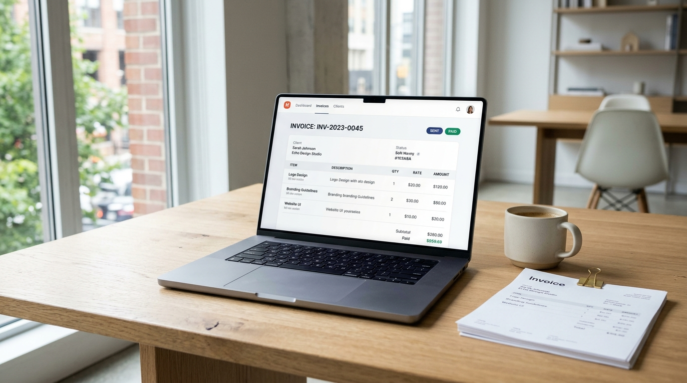
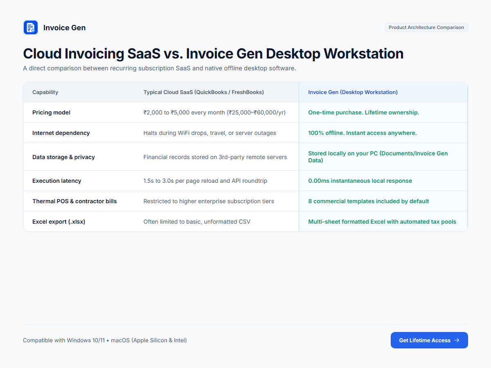
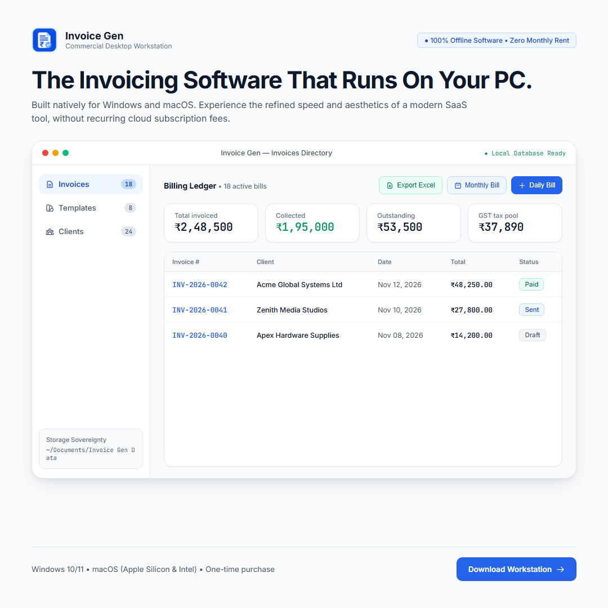

<p align="center">
  
</p>

<h1 align="center">Invoice Gen</h1>

<p align="center">
  <strong>Commercial Invoice & Billing Workstation</strong><br />
  <em>Fast, private, offline-first billing system for Windows, macOS, Android, and Web.</em>
</p>

<p align="center">
  <a href="https://github.com/rushikeshnarule/invoice-gen/releases/latest">
    
  </a>
  
  
  
  
</p>

---

<p align="center">
  
</p>

---

## 🌟 Overview

**Invoice Gen** is a commercial-grade, multi-platform billing workstation engineered for freelancers, small business owners, contractors, and retail merchants. Unlike cloud SaaS invoicing tools that charge subscription fees and hold your client data hostage, Invoice Gen is **100% offline-first**: all invoices, customer ledgers, company profiles, and financial metrics persist directly on your device.

Available as a native **Windows application**, **macOS PKG installer & DMG**, **Android APK**, and responsive **Web app**.

---

## 📥 Downloads (Latest Release v1.4.1)

Choose your operating system to download the latest production build:

| Operating System | Architecture | Package Format | Download Link |
| :--- | :--- | :--- | :--- |
| **🪟 Windows** | x64 | **NSIS Setup Wizard** | [⬇️ Download `Invoice-Gen-Setup-1.4.1.exe`](https://github.com/rushikeshnarule/invoice-gen/releases/download/v1.4.1/Invoice-Gen-Setup-1.4.1.exe) |
| **🪟 Windows** | x64 | **Portable (Zero-Install)** | [⬇️ Download `Invoice Gen 1.4.1.exe`](https://github.com/rushikeshnarule/invoice-gen/releases/download/v1.4.1/Invoice%20Gen%201.4.1.exe) |
| **🍏 macOS** | Apple Silicon (`arm64`) | **Native PKG Installer** | [⬇️ Download `Invoice-Gen-Setup-1.4.1-arm64.pkg`](https://github.com/rushikeshnarule/invoice-gen/releases/download/v1.4.1/Invoice-Gen-Setup-1.4.1-arm64.pkg) |
| **🍏 macOS** | Intel (`x64`) | **Native PKG Installer** | [⬇️ Download `Invoice-Gen-Setup-1.4.1-x64.pkg`](https://github.com/rushikeshnarule/invoice-gen/releases/download/v1.4.1/Invoice-Gen-Setup-1.4.1-x64.pkg) |
| **🍏 macOS** | Apple Silicon (`arm64`) | **DMG Disk Image** | [⬇️ Download `Invoice-Gen-1.4.1-mac-arm64.dmg`](https://github.com/rushikeshnarule/invoice-gen/releases/download/v1.4.1/Invoice-Gen-1.4.1-mac-arm64.dmg) |
| **🍏 macOS** | Intel (`x64`) | **DMG Disk Image** | [⬇️ Download `Invoice-Gen-1.4.1-mac-x64.dmg`](https://github.com/rushikeshnarule/invoice-gen/releases/download/v1.4.1/Invoice-Gen-1.4.1-mac-x64.dmg) |
| **🤖 Android** | Universal | **Android APK** | [⬇️ Download `Invoice-Gen-1.4.1.apk`](https://github.com/rushikeshnarule/invoice-gen/releases/download/v1.4.1/Invoice-Gen-1.4.1.apk) |

> 📁 Looking for previous releases? Check out the [All Releases Archive](#-releases--version-history) or visit [GitHub Releases](https://github.com/rushikeshnarule/invoice-gen/releases).

---

## 📸 Product Showcase

<p align="center">
  
  
</p>
<p align="center">
  
  
</p>

---

## ✨ Key Features

### ⚡ Rapid Commercial Billing Engine
- **Live Document Synchronizer**: Instant two-way synchronization between data input and live document preview.
- **Dynamic Line Items**: Unlimited items, per-item descriptions, quantity, rates, and individual or global discounts.
- **Smart Math Calculations**: Automatic subtotal, multi-tier tax computations, shipping, rounding, and total calculations.
- **Payment Terms & Due Dates**: Presets for Net 15, Net 30, Due on Receipt, or custom calendars.

### 💰 Comprehensive Dual Tax Engine
- **Indian GST Framework**: Automatic split for CGST, SGST, and IGST with HSN/SAC code tracking.
- **US State Sales Tax Engine**: Dedicated US tax engine with configurable state sales tax rates, exemptions, and regional presets.
- **Global Tax Mode**: Support for standard VAT, flat consumption tax, or completely tax-exempt commercial billing.

### 🎨 Multi-Template & Print System
- **Curated Themes**: Choose from Corporate, Modern Minimal, Minimal Gold, Thermal POS Receipt, Cyber Slate, and Excel Ledger layouts.
- **Vector PDF Output**: Crisp, print-ready vector PDF rendering with customizable fonts and margins.
- **Thermal POS Support**: Print 80mm and 58mm POS receipt vouchers directly to thermal receipt printers.
- **Branding & Identity**: Upload custom logos, signature stamps, watermark stamps, and company headers.

### 📲 QR Codes & Barcodes
- **Instant Payment QR Codes**: Generate dynamic UPI payment codes (Google Pay, PhonePe, Paytm, BHIM) and international banking payment links.
- **Product Barcodes**: Integrated Code 128 / QR barcode generation for product tracking and invoice authentication.

### 📱 Responsive Mobile & Touch Workstation
- **Native Android App**: Powered by Capacitor 7, giving you the full billing workstation on your smartphone or tablet.
- **Thumb-Friendly Bottom Navigation**: Sleek bottom navigation bar replacing the sidebar on mobile devices.
- **Mobile Segmented View**: Seamless switch between full-screen `✍️ Edit Form` and edge-to-edge `👁️ Live Preview`.
- **Safe Area Aware**: Full compatibility with modern Android and iOS displays with camera cutouts and notches.

### 🔒 100% Privacy & Offline-First
- **Zero Cloud Lock-in**: No account sign-ups, no monthly subscriptions, and no telemetry tracking.
- **Local Data Persistence**: Data is safely stored in browser local storage and IndexedDB, persisting reliably across app restarts.
- **Excel Import / Export**: Export invoices, customer ledgers, and inventory items to `.xlsx` workbooks anytime.

---

## 🛠️ Installation Guide

### 🪟 Windows Installation
1. Download `Invoice-Gen-Setup-1.4.0.exe` or portable `Invoice Gen 1.4.0.exe`.
2. Run the installer and follow the on-screen steps.
3. *Note*: If Microsoft SmartScreen shows "Windows protected your PC", click **More info** ➔ **Run anyway**.

### 🍏 macOS Installation
Invoice Gen provides both a native Apple Setup Wizard (`.pkg`) and a standard Disk Image (`.dmg`).

#### Recommended: Native PKG Wizard
1. Download `Invoice-Gen-Setup-1.4.0-arm64.pkg` (for Apple Silicon M1/M2/M3/M4) or `Invoice-Gen-Setup-1.4.0-x64.pkg` (for Intel Macs).
2. Double-click the `.pkg` file to launch the macOS Installer Wizard.
3. The app is automatically installed directly into `/Applications/Invoice Gen.app`.

#### If macOS blocks unnotarized apps:
Open your Terminal and run:
```bash
xattr -cr "/Applications/Invoice Gen.app"
```
Or right-click the app in Finder and choose **Open**.

### 🤖 Android Installation
1. Download `Invoice-Gen-1.4.0.apk` onto your Android phone or tablet.
2. Open the downloaded file in your Files or Downloads app.
3. Allow **Install from unknown sources** when prompted by Android, then tap **Install**.

---

## 📦 Packages & Tech Stack

Invoice Gen is built with a modern, high-performance web and desktop architecture:

| Component | Technology | Version | Purpose |
| :--- | :--- | :--- | :--- |
| **Frontend UI** | [React](https://react.dev/) | `^19.3.1` | Core reactive user interface |
| **Language** | [TypeScript](https://www.typescriptlang.org/) | `~7.0.2` | Type safety and robust codebase |
| **Build Tool** | [Vite](https://vite.dev/) | `^8.3.5` | Lightning-fast development & bundling |
| **Desktop Runtime** | [Electron](https://www.electronjs.org/) | `^45.2.2` | Cross-platform desktop shell |
| **Desktop Packager** | [electron-builder](https://www.electron.build/) | `^26.18.0` | NSIS, DMG, PKG, and portable builders |
| **Mobile Runtime** | [Capacitor](https://capacitorjs.com/) | `^8.6.2` | Native Android mobile application bridge |
| **Styling** | [Tailwind CSS](https://tailwindcss.com/) | `^4.3.4` | Modern responsive styling & design tokens |
| **Icons** | [Remix Icon](https://remixicon.com/) | `^4.9.0` | Production vector iconography |
| **Excel Engine** | [ExcelJS](https://github.com/exceljs/exceljs) & [xlsx](https://sheetjs.com/) | `^4.4.0` | Spreadsheet generation and parsing |
| **QR Code Engine** | [qrcode](https://github.com/soldair/node-qrcode) | `^1.5.4` | High-density vector & raster QR generation |
| **Linter** | [Oxlint](https://oxc.rs/) | `^1.89.0` | High-speed static analysis |

---

## 💻 Developer Quickstart

### Prerequisites
- [Node.js](https://nodejs.org/) (version 20 or higher recommended)
- `npm` or `pnpm`
- (For Android) [Android Studio](https://developer.android.com/studio) and JDK 21
- (For macOS PKG) macOS environment with `pkgbuild` / `productbuild`

### 1. Clone & Install Dependencies
```bash
git clone https://github.com/rushikeshnarule/invoice-gen.git
cd invoice-gen
npm install
```

### 2. Start Development Server
```bash
# Run web version with Hot Module Replacement
npm run dev

# Run desktop version with Electron
npm run electron:start
```

### 3. Build & Package Commands
```bash
# Build web production bundle
npm run build

# Package Windows NSIS installer
npm run package:exe

# Package Windows portable executable
npm run package:portable

# Package Windows US Edition
npm run package:us:exe
npm run package:us:portable

# Package macOS PKG installer (on macOS)
npm run package:mac:pkg

# Package macOS DMG installer (on macOS)
npm run package:mac:dmg

# Sync mobile app with Capacitor Android
npm run package:android
```

---

## 🗂️ Project Structure

```
invoice-gen/
├── .github/
│   └── workflows/              # CI/CD pipelines (macOS PKG & Android APK)
├── android/                    # Native Android Capacitor wrapper
├── build/                      # Desktop icon and installer graphics (.ico, .icns, .png)
├── dist/                       # Compiled production web bundle
├── dist-electron/              # Compiled Electron desktop binaries
├── docs/                       # Documentation and version release notes
│   ├── releases/               # Detailed release documentation per version
│   └── ADDING_A_THEME.md       # Guide for adding custom invoice themes
├── electron/                   # Electron main process & IPC handlers
├── marketing-assets/           # Product screenshots, banners, and promotional kits
├── public/                     # Static assets, template JSON schemas, and web icons
├── release-apk/                # Output directory for Android APK binaries
├── scripts/                    # Build and packaging automation scripts
├── src/                        # Core React application source
│   ├── components/             # Reusable UI components & modals
│   ├── hooks/                  # Custom React hooks (storage, calculation, print)
│   ├── types/                  # TypeScript data interfaces & types
│   ├── utils/                  # Tax calculations, currency formatters, PDF helpers
│   ├── App.tsx                 # Main application controller
│   └── main.tsx                # Application root entry point
├── package.json                # Project dependencies, scripts, and electron-builder config
└── README.md                   # Project documentation
```

---

## 📜 Releases & Version History

All builds and releases are hosted directly on [GitHub Releases](https://github.com/rushikeshnarule/invoice-gen/releases):

| Version | Release Date | Highlights | Supported Platforms | Direct Links |
| :--- | :--- | :--- | :--- | :--- |
| **v1.4.1** | 2026-11-15 | In-App Auto-Updater, Live Progress Bar, Direct In-App Installation | Windows, macOS, Android, Web | [Release Notes](docs/releases/v1.4.1.md) • [Assets](https://github.com/rushikeshnarule/invoice-gen/releases/tag/v1.4.1) |
| **v1.4.0** | 2026-11-15 | Native macOS PKG Wizard, Android APK, Mobile UI/UX Overhaul | Windows, macOS, Android, Web | [Release Notes](docs/releases/v1.4.0.md) • [Assets](https://github.com/rushikeshnarule/invoice-gen/releases/tag/v1.4.0) |
| **v1.3.3** | 2026-11-12 | US Sales Tax Engine, US Edition builds, High-Density Preview | Windows, macOS, Web | [Release Notes](docs/releases/v1.3.3.md) • [Assets](https://github.com/rushikeshnarule/invoice-gen/releases/tag/v1.3.3) |
| **v1.3.0** | 2026-11-05 | Live Template Customizer, Persistent Storage, Separated Print/PDF | Windows, macOS, Web | [Release Notes](docs/releases/v1.3.0.md) • [Assets](https://github.com/rushikeshnarule/invoice-gen/releases/tag/v1.3.0) |
| **v1.2.0** | 2026-11-04 | Initial macOS DMG Foundation Release | macOS | [Release Notes](docs/releases/v1.2.0.md) • [Assets](https://github.com/rushikeshnarule/invoice-gen/releases/tag/v1.2.0) |

---

## 📄 License

This project is licensed under the [MIT License](LICENSE).

---

<p align="center">
  <sub>Developed with ❤️ by the Invoice Gen Team</sub>
</p>
